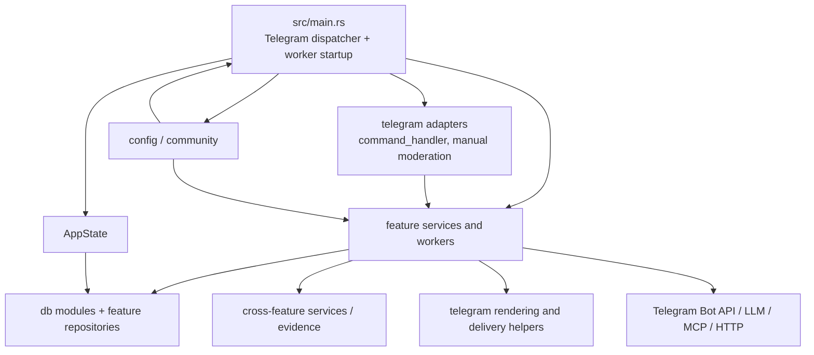
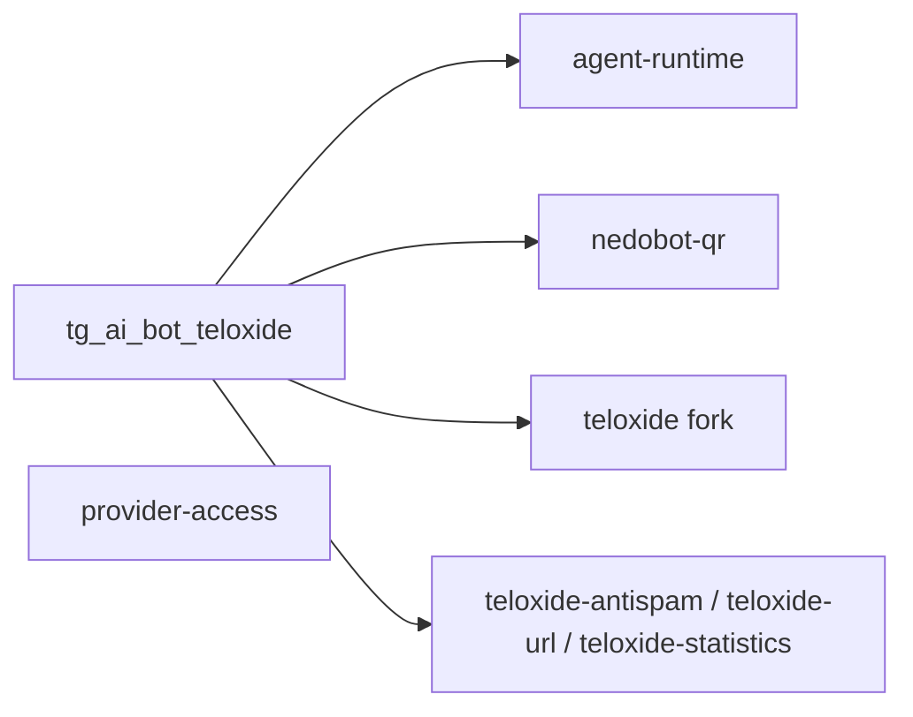
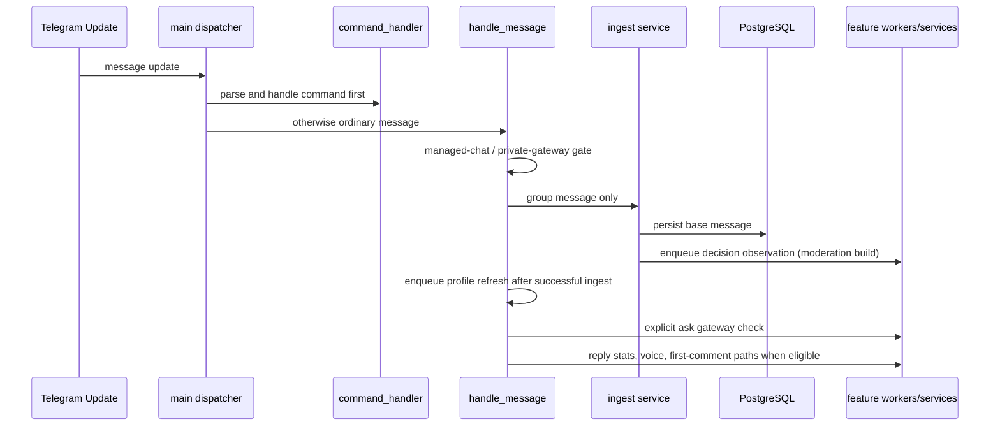

# NedoBot architecture map

This describes the current implementation at the T03 baseline. It records actual call and ownership boundaries; it is not a claim that the code already follows a future ports-and-adapters design.

## Workspace and runtime graph

The workspace is a Cargo workspace with the root bot crate plus `agent-runtime`, `provider-access`, and `nedobot-qr` (`Cargo.toml`). Feature flags select compiled modules; the selected community TOML and environment values decide which compiled services actually run (`src/features/mod.rs`, `src/main.rs`, `src/config.rs`). Both are required gates.

The current directed crate edges are narrower than workspace membership:

`provider-access` is a workspace crate but the root bot does not currently import it (no `provider_access` reference or path dependency in the root manifest). Do not infer runtime integration from workspace membership alone. Internal crate edges are visible in the root `Cargo.toml` and the corresponding crate manifests.

## Telegram ingress and effects

The dispatcher and worker startup are in [`src/main.rs`](../src/main.rs). Message updates use a command-first `dptree` branch, then the ordinary message endpoint. The common branch is covered by T02 tests.

`handle_message` rejects unknown chats before persistence; configured private ask users are a separate explicit exception. Group ingest is performed by [`features/ingest/service.rs`](../src/features/ingest/service.rs), which owns the managed-chat/ingest check and delegates base-message persistence to `db::telegram`. A failed ingest exits the handler. An `ingest=false` chat can still use an independently enabled ask gateway because invocation detection precedes the `message_ingested` early return. Profile refresh is queued only after successful group ingest and excludes bot, anonymous, and automatic-forward sources.

Commands use [`telegram/command_handler.rs`](../src/telegram/command_handler.rs), a large Telegram adapter that currently also coordinates authorization gates, domain calls, SQL queries and replies. Other update branches cover reactions, edited messages, callbacks (moderation build), and chat-member events. Long-running work is generally started from `main.rs` as workers and uses feature repositories for lease/state transitions; the source of truth is the SQL job row, not an in-memory queue.

## Source of truth and side-effect ownership

| Concern | Current owner / source of truth | Side effects and boundary |
|---|---|---|
| Instance, chat and feature configuration | `Config` parsed from community config plus environment (`src/config.rs`, `src/community/`) | Runtime validation happens before dispatcher startup; feature code receives validated config. |
| Runtime resources | `AppState` (`src/state.rs`) | Holds the PostgreSQL pool, validated config, formatter, concurrency controls, bot identity and feature-gated caches. It is shared by dispatcher handlers and workers. |
| Base Telegram message history | `db::telegram` plus PostgreSQL migrations | `features::ingest` is the gate; DB module owns neutral base message persistence. Feature evidence is stored separately. |
| Durable background work | Feature repository tables and `features/jobs` policy/observability | Repositories own claims, leases, retries, and terminal transitions. In-memory channels are bounded wake-up/coalescing mechanisms, not durable job state. |
| New-user and decision audits | `features/new_user_analysis`, `features/new_user_audit`, `features/decision_audit` repositories | Profile refresh, message observation, QR/URL evidence and worker materialization update DB snapshots/jobs. Decision calls are made by the audit worker. |
| Moderation actions | `features/manual_moderation`, `features/risk_captcha`, `features/reports`, `features/spam_review` | Telegram sanctions/delivery are external effects; DB audit and operation state are the durable record. Commands and callback handlers enforce runtime chat/admin gates. |
| Ask conversation state | `features/ask` repositories, conversation memory, notes and MCP client | Private memory and notes are database state scoped by instance/profile/chat/user; MCP reads use the configured reviewed database views. Telegram delivery is in the adapter. |
| URL and QR evidence | `db::url_evidence`, `features/qr_url`, `features/url_relations`, `features/url_feeds` | Telegram file fetch is in the QR worker. Parsed targets and local relations are stored; configured linked-channel refresh is a Bot API call. |
| User profile enrichment | `db::telegram` and `features/user_profiles` | Queue bounds refresh work; Telegram profile/photo fetch is an external read; derived profile/evidence is persisted. |
| Voice transcription | `features/voice` repo and job table | Media download, external ASR, cleanup, progress/final delivery are currently coordinated by `voice::pipeline`. |

## Domain map

| Domain | Commands / queries / events | Storage | External dependencies and gates | Data privacy |
|---|---|---|---|---|
| Ingest | Message and command message persistence; managed chat lookup; profile refresh enqueue | `telegram_messages`, profiles | Telegram Update; PostgreSQL; base module ungated | Internal group content, restricted to configured instance/chat paths |
| New-user / decision audit | Profile-refresh and message-observation events; audit queue claim/result queries | profile snapshots, audit jobs, decisions, evidence and review rows | Telegram profile fetch; configured decision/LLM provider; `moderation` build + per-chat runtime gates | User identifiers, profile signals and message excerpt; bounded/redacted prompt inputs and scoped DB records |
| URL / QR relations | URL evidence refresh; QR scan job; linked chat and membership queries | URL/QR evidence, membership snapshots, linked-chat cache | Telegram file and configured linked-chat Bot API reads; QR crate; `moderation` | Link targets and message references; relation uses explicit IDs/local snapshots, no arbitrary username resolution |
| Manual moderation / captcha / reports | `/mute`, `/ban`, `/warn`, `/report`; callbacks; pending captcha/report delivery | moderation operations, warnings, reports, captcha and job state | Telegram send/restrict/delete operations; `manual-moderation` / `moderation` plus runtime policy | User IDs, action reason, audit history; owner/admin gated |
| Ask / memory / search | `/ask`, mention/reply gateway, `/forget`, notes; recent messages, search and MCP tool queries | runs, tool audit, notes, scoped conversation turns | LLM profile, MCP transport, optional search providers and Python sandbox; `ask` build + gateway/chat gates | Private conversational data; instance/profile/chat/user scope and MCP reviewed views are security boundaries |
| First comment | New channel-post candidate; durable generation and delivery job queries | comment jobs, source snapshot, delivery audit | LLM, configured search/MCP, Telegram discussion send; `auto-comment` build + runtime setting | Public source post plus bounded chat evidence; job source/revision controls |
| Voice | Voice-message enqueue and `/transcribe` reply; job/status queries | voice jobs and transcript result | Telegram file download, ASR providers, progress/final send; `voice` build + runtime pipeline | Audio and transcript are sensitive user content; bounded download and configured retention apply |
| Stats / memory reports | `/stats`, `/status`, `/top*`, memory report | message history, profile/member snapshots, notes | PostgreSQL; Telegram rendering/delivery | Chat-scoped content and user activity; chat feature gates and ephemeral audience policy |
| MCP read model | Generic scoped read/search tools and explicit public MCP endpoints | reviewed `mcp_public` views, manifest, instance scope | PostgreSQL; child/HTTP MCP transport; public exposure additionally opt-in | Internal read-only DB boundary; public MCP is a separate explicit gate |

The table is a navigation aid, not a complete command inventory. Detailed command dispatch and runtime gates remain in `telegram/command_handler.rs` and `Config` methods.

## Dependency rules

Intended direction for new code:

1. `main` and `telegram` are adapters: parse transport events, apply transport-specific gates, call feature services, translate results to Telegram delivery.
2. Feature policy/types should depend on their own domain types and shared config/value types; repositories may depend on SQLx and migrations.
3. Cross-feature calls are allowed only for an explicit service or evidence query, not by reaching into another feature's private persistence implementation.
4. `db` owns neutral persistence and schema migrations. Feature repositories own feature job/state transitions.
5. `state` is a runtime dependency container, not a service locator for domain code. Do not add global mutable state or an event bus.
6. External API clients and Telegram delivery should move behind typed ports as the corresponding T05/T08/T17 tasks land.

Current exceptions to the intended direction (not blanket permissions):

- Feature rendering/report modules import `telegram::html`, `telegram::render`, `telegram::entities`, and `telegram::service_messages` (`features/stats`, `reports`, `memory`, `first_comment`, `voice`, `ask`, `spam_review`). These are shared presentation/Telegram error-classification helpers; T17 should introduce a narrower outbound delivery seam, and render helpers can later move to transport-neutral types.
- `features::voice::pipeline`, `features::stats::report`, `features::memory::report`, `features::reports`, and `features::spam_review` currently perform Bot API sends. They are feature orchestration modules with transport effects, scheduled for ports work; they do not import or call the command router.
- `telegram::command_handler` directly imports many feature modules and contains significant orchestration. This is the largest adapter/domain boundary hotspot; T07/T08 are intended to split command families behind service entry points.
- Cross-feature evidence dependencies include `ingest -> decision_audit`, `qr_url -> url_relations -> url_feeds/membership`, and `qr_url -> new_user_analysis` for refreshing a materialized shadow observation. These are current synchronous orchestration paths, not independent event delivery.

No import guard is added in T03. A textual ban on `crate::telegram` under `features` would reject legitimate existing rendering helpers; a narrower ban on router modules has no current violating imports and would provide little value until the router is split. Re-run the explicit source scan (`rg -n 'crate::telegram::(command_handler|commands|manual_moderation)' src/features`) during router extraction; expected result is empty.

## Hotspots and follow-up boundaries

- **New-user analysis ↔ URL relations:** `new_user_analysis` combines profile-derived signals with URL evidence, feed snapshot and materialization; `url_relations` classifies targets using configured linked chats and membership. Keep relation classification deterministic and avoid network resolution of user-supplied names.
- **Ingest ↔ decision audit:** base save calls the cheap decision observer inline. Errors are intentionally non-fatal, but ingest latency and orchestration are coupled. T05 can move the notification to an explicit typed effect after preserving ordering and tests.
- **QR ↔ shadow refresh:** QR worker owns Telegram file download and decoding, then classifies URL relations and invokes new-user shadow refresh when a current message materializes. This has stale-job guards in the QR/evidence repositories and must stay revision-aware.
- **Command handler ↔ AppState:** handler passes `Config`, `PgPool`, and `Bot` through large match branches. Feature gates are split between compile-time Cargo flags and runtime configuration; preserve both while extracting use cases.
- **Direct worker startup in main:** startup conditions, retry loops and logging live in `main.rs` or feature worker modules. T11 will standardize lifecycle without changing durable feature-specific state machines.

## Manual graph review

For this snapshot, `rg` over `src/features` found no imports of `telegram::command_handler`, `telegram::commands`, or `telegram::manual_moderation`; the allowed imports are listed above. Re-run that scan after T06–T09. No source behavior, dependencies, config schema, SQL schema or production settings were changed by T03.
