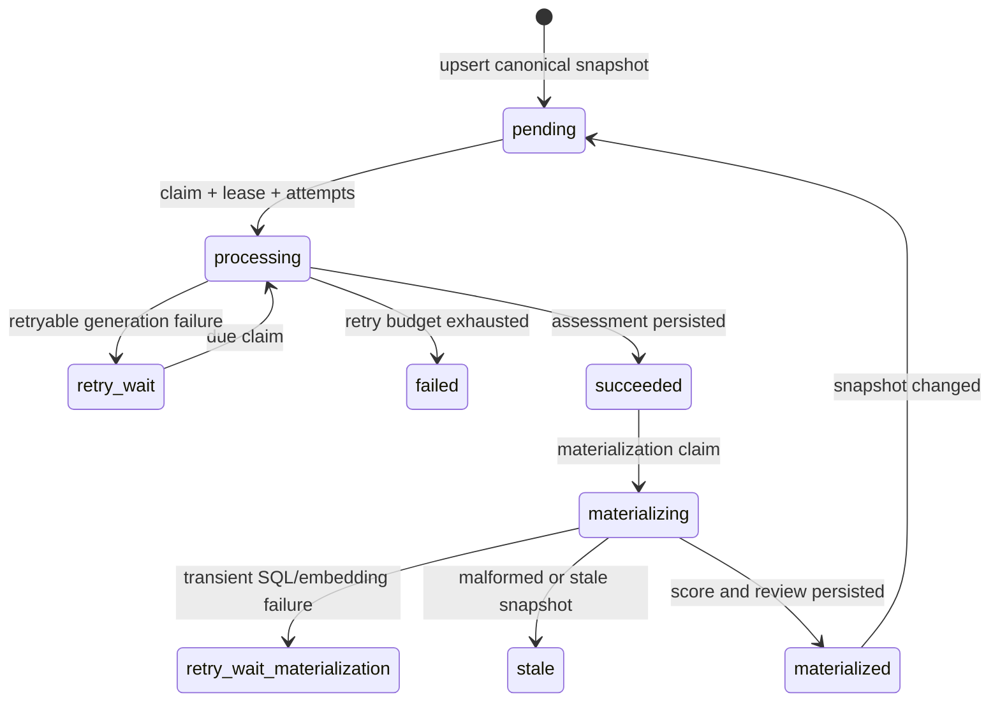

# Единый lifecycle аудита нового пользователя

Проверка нового пользователя — один доменный процесс на пару
`(chat_id, telegram_user_id)`:

1. refresh профиля;
2. bounded snapshot профиля, поведения, первого сообщения и аватара;
3. точные детерминированные проверки известных кампаний; если они не сработали — один LLM audit на route `new_user_audit`;
4. атомарная materialization score/signals и review request;
5. отдельная bounded Telegram delivery при включённых moderation/review-delivery flags и `risk_score >= review_threshold` для сохранённого запроса; маршрут и reviewer задаёт инстанс.

Audit job, assessment, score и `spam_review_requests` сохраняются независимо от
возраста первого сообщения. Если первому сообщению уже больше 5 минут, review
request остаётся в БД для аудита, но не claim-ится и не отправляется в Telegram.

Avatar и first-message являются секциями единого assessment. Отдельных
очередей, LLM routes и workers для них нет. Старые таблицы и миграции остаются
в БД для backward compatibility, но runtime их больше не enqueue-ит и не
обрабатывает.

Для управляемых чатов с включённой модерацией перед LLM проверяются
высокоуверенные комбинации признаков среди участников не старше 3 дней и с не
более чем 10 сообщениями. Лексические семейства, веса, пороги, обязательные и
альтернативные признаки находятся в
`src/features/new_user_audit/spam_features.toml`; Rust извлекает общие сигналы
экономического предложения, найма, контакта, выполнения задания, выдачи займа,
пробного товара, рекламного материала и дефицита, затем проверяет
конфигурируемые сочетания. Признаки
нормализуются с учётом homoglyphs и смешанной латиницы в кириллических словах.
Это покрывает вариации денежного DM-промо, предложения заработка, короткой
оплачиваемой задачи и товара «на пробу» с ограничением мест; adult-ссылки в
личном канале остаются отдельным подтверждённым сигналом. Совпадение сохраняет
версию и сработавшие признаки в job input, создаёт assessment и пропускает
внешний LLM-вызов. При
materialization участник и его сообщение получают durable spam-разметку через
`features::labels::record_spam`. Сильный детерминированный campaign marker
является подтверждённым auto-ban evidence; captcha для такого совпадения
пропускается, а само действие остаётся за `enforce_enabled`, `enforce_dry_run`
и общей moderation policy. Системные метки не попадают в curated датасет
аватаров и ручной template-корпус; их можно отменить обычным `/notspam`.

## State machine



Generation and materialization have independent leases. A successful LLM
response is persisted before materialization starts, so SQL or embedding
failures never reopen LLM generation. A stale snapshot cannot overwrite a
newer baseline.

## Score ownership

The final score is rebuilt from idempotent components:

```text
final_score = clamp(baseline_score + first_message_delta + avatar_delta, 0, 100)
```

The materializer writes the audit row and upserts one review request in the
same transaction. Telegram delivery is a separate worker and never changes the
score.

## Guarantees

- one claim owner: `FOR UPDATE SKIP LOCKED`, lease and CAS;
- bounded generation and materialization retries with terminal states;
- missing avatar is a valid text-only assessment, not an endless retry;
- one audit job and one review request per canonical snapshot/user;
- first-message age over five minutes suppresses only Telegram review delivery, while the DB audit/review row remains;
- score `69` has no delivery attempt, score `70` is claimable;
- stale workers cannot change score, signals or review state.

Historical migration files and tables are intentionally not dropped: they may
already be applied to production databases. They are no longer part of the
application flow or reviewed MCP catalog.
